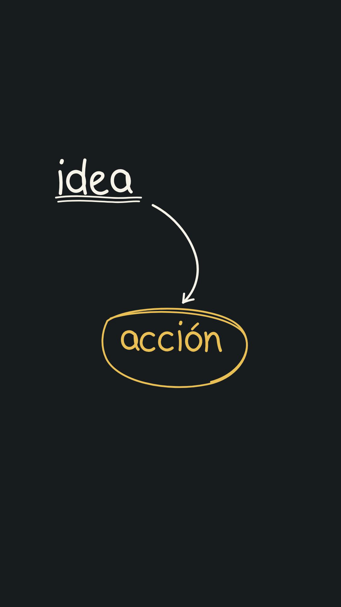

# human-handdraw

[](https://agentskills.io)
[](https://developers.openai.com/codex/)
[](https://code.claude.com/docs/en/skills)
[](https://www.remotion.dev/)
[](https://www.typescriptlang.org/)
[](LICENSE)

`human-handdraw` is an Agent Skill for planning and producing transparent, silent hand-drawn overlays with Remotion. It creates handwriting, arrows, rough annotations, doodles, conceptual diagrams, and mind maps as progressively revealed SVG centerlines—without handwriting fonts or SVG text.

The skill uses an approval-first workflow:

1. Brief and message design.
2. Static composition and timing plan.
3. Explicit approval.
4. Remotion implementation from the bundled starter.
5. Opaque review MP4 and iteration.
6. Transparent ProRes 4444 master and editable source.

## Install

Clone this repository, then copy or symlink the repository folder into the personal skills directory used by your agent.

### Codex

```bash
mkdir -p ~/.codex/skills
ln -s /absolute/path/to/human-handdraw ~/.codex/skills/human-handdraw
```

If your Codex setup uses the shared Agent Skills directory, link it under `~/.agents/skills/` instead.

### Claude Code

```bash
mkdir -p ~/.claude/skills
ln -s /absolute/path/to/human-handdraw ~/.claude/skills/human-handdraw
```

Restart the client if it does not detect a newly created top-level skills directory.

## Invoke

Ask naturally for a handwritten transparent overlay or invoke it explicitly:

```text
$human-handdraw Create a conceptual overlay about turning an idea into action.
```

The skill always asks whether the visible copy should be Spanish or English. Skill instructions and repository documentation are in English.

## Example



The complete writing sequence is available in [`examples/preview.mp4`](examples/preview.mp4), and its approved plan is documented in [`examples/approved-plan.md`](examples/approved-plan.md).

## Requirements

- Node.js and npm
- A system able to run Remotion and Chromium
- `ffprobe` recommended for media validation

## Repository layout

- `SKILL.md`: compact workflow and authorization boundaries.
- `references/`: brief, visual-language, and export guidance loaded when needed.
- `scripts/create-project.mjs`: creates a clean project from the starter.
- `assets/remotion-starter/`: reusable Remotion primitives and example composition.
- `examples/`: example approved plan.

## Development

Validate the skill package with the official Codex skill validator:

```bash
python3 /path/to/skill-creator/scripts/quick_validate.py .
```

Test project generation:

```bash
node scripts/create-project.mjs /tmp/human-handdraw-test test-overlay
cd /tmp/human-handdraw-test
npm ci
npm run check
```

## License

MIT
